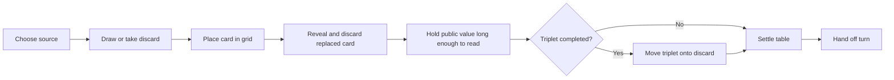

# Game Flow Research and Plan

Make playing against computer opponents feel like an enjoyable, observable game at a table. Cards should have convincing movement, small sounds, and a natural rhythm. The human should be able to follow every public action and choose a comfortable pace.

The existing SkyjoDemo is a proof of concept for playable rules and computer opponents. This document plans the next presentation experiment. It builds on [[Projects/Skyjo/UI Explorations|UI Explorations]], [[Projects/Skyjo/Design|Design]], [[Projects/Skyjo/App Comps|App Comps]], and [[Mobile Card Games — Landscape]]. The existing no-advertising decision and focus on solo play against computers apply here.

## Research Scope

Desk research completed September 16, 2026: official App Store listings, selected player reviews, publisher release notes, Apple's design guidance, and the POC code reviewed in this conversation. Five games were selected for mechanical similarity, audience size, or a useful presentation comparison.

This is a qualitative sample, not a representative survey or a new bulk review scrape. Duplicate review renderings were treated as one review. Older reviews are identified because they describe historical experiences, not verified current defects. Store dates that omit a year are recorded as displayed. Complaints about rigged cards establish a trust problem; they do not establish that a competitor manipulates cards.

No competitor was installed or played during this research. Animation durations, gesture feel, audio levels, and current speed controls still need the short hands-on comparison below. All proposed timings are starting points for experiments, not measurements from competitors.

## Comparable Games

Rounded US App Store figures below are point-in-time observations on the research date, not active-player counts. The Australian review used for Exploding Kittens 2 is explicitly labeled.

| Game | Audience Signal | Why Study It | What the Sources Suggest |
|---|---|---|---|
| [Play Nine: Golf Card Game](https://apps.apple.com/us/app/play-nine-golf-card-game/id1567060312) | About 39K ratings, 4.8 | Closest match: hidden grid, two initial flips, draw or discard, replacement, matching columns, low score, offline AI. | Familiar physical play is appealing. Reviews also describe frustrating waits, confusing state changes, and suspicion about draws. Track whether the human can reconstruct each move. |
| [Skip-Bo](https://apps.apple.com/us/app/skip-bo-solitaire-card-game/id1538912205?platform=ipad&see-all=reviews) | About 214K ratings, 4.9 | Repeated dealing, flips, moving cards between piles, and observing opponents. | Reviewers praise relaxing, faithful play and playing with family. Two specifically object to faster animations and ask for speed choice. This is the strongest direct evidence for adjustable pacing. |
| [UNO!](https://apps.apple.com/us/app/uno/id1344700142?see-all=reviews) | About 652K ratings, 4.7 | Recognizable turn handoffs, draw/discard actions, opponent attention, and special events. | A featured review enjoys the challenge but describes currency depletion interrupting play. Useful for studying clear turns and momentum; its economy is outside this project's chosen model. |
| [Solitaire by MobilityWare](https://apps.apple.com/us/app/solitaire-by-mobilityware/id284791396) | About 138K ratings, 4.8 | A mature example of repeated card manipulation, personal settings, and quiet solo play. | Reviews value familiar play and customization. Complaints about intrusive goal animations and audio behavior reinforce the need for restraint and controls. This is the paid listing, distinct from its free and Arcade editions. |
| [Exploding Kittens 2](https://apps.apple.com/us/app/exploding-kittens-2/id6478287619?platform=ipad) | About 3.8K ratings, 4.8 | A smaller premium comparison for animated card actions, anticipation, and personality. | A US review praises enjoyable pacing when players participate. Historical complaints and subsequent release notes show that expressive animation can accumulate into excessive waiting. |

### Review Evidence Worth Carrying Forward

| Evidence | Interpretation for Skyjo |
|---|---|
| Skip-Bo: ~SaraDi~, Jun 26, says accelerated dealing and flipping became difficult to follow; 55555jj, May 15, describes feeling rushed and asks for slower/faster settings. Vercherms, Apr 25, enjoys relaxed play alongside music or TV. [Reviews](https://apps.apple.com/us/app/skip-bo-solitaire-card-game/id1538912205?platform=ipad&see-all=reviews) | Separate card travel speed from time to read a revealed value. Preserve a relaxed setting and coexist with other audio. |
| Exploding Kittens 2: Hinsy55, August 12, 2024, Australian storefront, complains about long waits and animations. Later release notes describe a setup-animation skip button and faster animations. A US review dated Apr 4 praises the pacing when everyone participates. [Australian listing and history](https://apps.apple.com/au/app/exploding-kittens-2/id6478287619?platform=ipad), [US review](https://apps.apple.com/us/app/exploding-kittens-2/id6478287619?platform=ipad) | Budget the entire wait until the human's next turn. Allow setup and repeat ceremonies to be shortened. The old criticism is a design lesson, not a claim about today's build. |
| Play Nine: Lindsay K. Siverson, November 22, 2023, enjoys the game but reports slow-playing opponents and visual/game-state mismatches; JohanAnders, May 19, 2024, suspects the AI receives favorable cards. [Listing](https://apps.apple.com/us/app/play-nine-golf-card-game/id1567060312), [review page](https://apps.apple.com/us/app/play-nine-golf-card-game/id1567060312?see-all=reviews) | Make ownership, destinations, reveals, and score changes explicit. Treat perceived unfairness as a playtest question, not proof of bad randomness. |
| MobilityWare paid Solitaire: Sparky 460, October 7, 2020, dislikes compulsory extras, then improves their assessment after finding the setting to disable goal animations. RangerMac61, February 13, 2024, praises customization but reports interference with hearing-aid audio despite muted game sounds. [Reviews](https://apps.apple.com/us/app/solitaire-by-mobilityware/id284791396) | Let players control embellishments. Verify mute and audio coexistence on actual devices, including Bluetooth. |
| UNO: the review titled "Actually pretty addicting," August 4, 2023, likes the challenge but describes being unable to keep playing after losing currency. [Review](https://apps.apple.com/us/app/uno/id1344700142?see-all=reviews) | Protect the uninterrupted play session. Do not confuse engagement with making the player wait to resume a game. |

The synthesis is a design inference: a convincing physical feel comes from understandable cause and effect, responsive handling, and controlled rhythm. Adding delay everywhere would not satisfy the mixed preferences in these reviews.

## Experience Proposal

### One Complete Turn First

Start with one human and two computer opponents. Build one excellent sequence: a player exchanges into a column, the replaced card becomes publicly readable, and a completed triplet moves onto the discard pile. This exercises movement, reveal timing, sound, identity, and the information gap found in the POC review.

The reject-and-flip branch is a separate sequence: choose to reject the drawn card and select the hidden target, then show the discard, flip the selected card, resolve any triplet, and hand off. Invalid or cancelled selection reveals nothing.

### Shuffle, Deal, and Arrangement

- Give the new round a short shuffle-and-square gesture, with a restrained paper sound. It represents the engine's shuffle; animation never determines card values or shuffles a second time.
- Animate the actual assigned cards into each seat and then into a four-column, three-row grid. Start with a packet-to-grid treatment that fits the engine's existing 12-cards-per-seat allocation. Overlap face-down flights so larger tables do not require watching 96 serial animations.
- Offer a skip-to-dealt-table action. Skipping setup must preserve exactly the same assignment and starting discard.
- Arrange the initial grid and square piles with small offsets and rotations. During play, logical column membership stays fixed. Do not sort cards by value, move cards between columns, or visually close gaps in a way that disguises their positions.
- Initial flips are individual, readable reveals. Announce the starting player only after all required opening flips have been shown.
- On draw-pile exhaustion, keep the top discard visible while the remaining discards gather, turn face down, shuffle, and become the draw pile.

### Interaction and Observation

- Support both tap-to-select/tap-to-place and drag-to-place. A card follows the finger directly, marks eligible destinations, and settles into the chosen slot. Picking it up acknowledges input immediately.
- A hidden destination stays hidden while hovering. Reveal the replaced card only after committing the move. An invalid drop returns the held card without changing the game.
- The human sees their own pending draw. An opponent's pending draw stays face down until it is publicly placed or discarded, matching the physical rules. The current POC shows all pending draws; adjust that presentation in the production flow.
- Every public reveal must be readable before another card covers it, including an exchanged card immediately followed by a triplet. Add a small, accessible recent-moves history containing public actions only.
- Keep the active opponent and relevant grid visible. At larger tables, use a stable active-player area or a brief contextual enlargement; do not rely on tiny offscreen grids. Avoid forced camera movement in the first prototype.
- After a player goes out, make each remaining player's final turn apparent. At scoring, show remaining reveals and qualifying column removals before adding round totals. Let the human finish inspecting the round before starting another.

### Pacing to Prototype

These are proposed Natural-mode ranges. Measure perception and total elapsed time before settling them. A reading hold starts after the face is fully visible and stationary.

| Moment | Initial Range | Reason |
|---|---|---|
| Acknowledge touch or pickup | Next rendered frame | Handling should respond immediately. |
| Ordinary slide/place | 180-280 ms | Clear origin and destination with a restrained settle. |
| Flip | 180-260 ms | Make the transition clear without a long flourish. |
| Newly public card that is about to be covered | 600-900 ms | Allow observation before a triplet or later action hides it. |
| Computer preparation before acting | 250-500 ms | A little anticipation; no delay added to human input. |
| Triplet gathering and discard | 300-450 ms | Show the three-card cause and the resulting empty column. |
| Turn handoff | 100-200 ms | A small separation after the table settles. |
| Shuffle and deal ceremony | Aim for 2-4 seconds total | Bound the whole ceremony; offer skip. |

Prototype Natural, Quick, and Deliberate settings. Quick compresses travel, setup, and computer preparation first; it still preserves reveal order and a readable minimum hold. Deliberate extends observation time. Recent-move inspection and pause remain available at every speed. Reduced Motion is a separate preference, not a synonym for faster play.

Measure complete turns as well as individual animations: an initial working target is roughly 1.2-2.0 seconds for a routine computer turn and 2.0-3.0 seconds for a reveal-plus-triplet turn. These are targets to tune, not additional waits. At seven opponents even two-second turns create a fourteen-second wait; test that table separately and avoid stacking seven elaborate ceremonies.

### Small Variations

- Vary decorative timing within a narrow bound, initially about +/-10%, while enforcing the minimum public-reading hold. Sample once for each action; do not resample on view updates.
- Give placed cards a small stable rotation, initially within +/-1.5 degrees, and a small position offset within their reserved slot. Keep numerals clear and hit targets fixed.
- Try several recorded paper-slide/place variations, with subtle level variation and at most slight pitch variation. Preserve a consistent sound identity for each action.
- Use a separate cosmetic random generator. Changing animation speed, sound settings, layout, or cosmetic seed must not change the deal, moves, or AI decisions.
- Treat personality-based pacing as a later experiment. Extra thinking time is not evidence that a bot is smarter, and arbitrary long hesitations may simply feel slow.

### Sound, Touch, and Comfort

Use a small vocabulary: shuffle, draw/slide, flip, place/discard, triplet sweep, and round completion. Emphasize contact and arrival; many cards moving together should not produce an overwhelming stack of sounds. Start with quiet table sounds and no music by default, consistent with the existing exploration.

Sound and haptics have independent controls. Haptics should accompany the human's pickup/placement and a few meaningful outcomes; do not vibrate for every opponent card. Apple's guidance favors consistent, optional, restrained feedback synchronized with visible causes. [Apple: Playing haptics](https://developer.apple.com/design/human-interface-guidelines/playing-haptics)

Use audio behavior appropriate for incidental effects: respect Silent Mode and allow the player's music or podcast to continue. Apple's Ambient category is designed for that combination. Test actual device volume, interruptions, headphones, and Bluetooth behavior. [Apple: Playing audio](https://developer.apple.com/design/human-interface-guidelines/playing-audio?changes=l_7__1_1_8)

Reduced Motion replaces flips, travel, and rotation with restrained transitions while retaining readable states and event order. Provide VoiceOver actions and announcements, scalable readable values, and non-color turn/selection cues. System guidance specifically preserves meaning when reducing motion. [Apple: Reduced Motion evaluation](https://developer.apple.com/help/app-store-connect/manage-app-accessibility/reduced-motion-evaluation-criteria/)

## Implementation Plan

### Fit With the Existing POC

The engine already returns ordered `GameEvent` values for draws, exchanges, flips, column removals, reshuffles, and round/game completion. Today, `GameFeature` discards those events and directly exposes the resulting state; computer actions are driven by a repeating 0.7-second tick. A move that exchanges a card and removes a triplet therefore reaches the view as one already-completed update.

Use the existing local ComposableArchitecture2 feature structure to add a presentation state and a cancellable sequence of presentation steps:

1. Accept a legal action once and capture the engine state before it, the resulting event batch, and the state after it.
2. Build the visible sequence from those events. Keep the table, discard top, current-player indicator, and displayed scores at the appropriate intermediate stage.
3. Complete the visual steps in order, with deliberate reading holds. Drive sound and haptics from the corresponding step, not from view re-rendering.
4. Reconcile the displayed table with the resulting engine state. Only then enable the next game action or schedule the next computer decision.

This keeps rule resolution deterministic while letting the human observe the transitions. Presentation does not calculate scores or determine legal moves. Build this for Skyjo first; extract shared card-game components when another real use case establishes their shape.

Details that matter for a reliable first implementation:

- Give visual cards stable identities independent of their values: the three sevens in a triplet must remain three separate moving cards. The engine's `Card` is value-based.
- Synthesize shuffle/deal presentation from the initialized round and its actual assigned cards; the current initializer does not emit a deal-event timeline. Preserve existing hands when skipping or replaying presentation.
- Replace the repeating bot tick with completion-driven scheduling. At most one computer action may be pending. A new game cancels old work; the old game's delayed completion cannot advance the new one.
- Disable conflicting game actions during committed playback, while keeping pause, speed, settings, and public history usable. Selection feedback remains immediate when input is available.
- Pause computer progression while the app is inactive, a modal obscures play, or the user is inspecting history. Resume without applying a committed move twice or skipping unread public events.
- A skip/fast-forward operation resolves presentation exactly once and retains all public events in history. Do not reveal private pending draws in that history, VoiceOver labels, or intermediate card faces.

Code entry points: [GameFeature.swift](/Users/dwsjoquist/ivygulch/ios/projects/tca/SkyjoDemo/SkyjoDemoPackage/Sources/GameFeature/GameFeature.swift:66), [GameView.swift](/Users/dwsjoquist/ivygulch/ios/projects/tca/SkyjoDemo/SkyjoDemoPackage/Sources/GameFeature/GameView.swift:108), [GameEvent.swift](/Users/dwsjoquist/ivygulch/ios/projects/tca/SkyjoDemo/SkyjoDemoPackage/Sources/SkyjoEngine/GameEvent.swift:1), and [GameState.swift](/Users/dwsjoquist/ivygulch/ios/projects/tca/SkyjoDemo/SkyjoDemoPackage/Sources/SkyjoEngine/GameState.swift:115).

### Stages and Completion Criteria

| Stage | Work | Done When |
|---|---|---|
| 1. Focused hands-on comparison | Start with Play Nine, Skip-Bo, MobilityWare Solitaire, and Exploding Kittens 2; use UNO if a turn-handoff question remains. Capture app version, device, mode, settings, and a short session. Measure travel, reveal dwell, setup duration, and total time between human turns. Note tap/drag behavior, skip, sound, and accessibility controls. | A short comparison sheet distinguishes measured behavior from reviewer reports and records what to borrow, adapt, or avoid. Target a bounded 60-90-minute first pass. |
| 2. Observable-turn prototype | One human, two bots; implement the event sequence for draw/swap and exchange-plus-triplet. Add basic speed controls, pause, public history, and simple Reduced Motion behavior. | A viewer can identify the exchanged card even when the triplet immediately covers it. All speed modes produce the same game outcome. |
| 3. Tactile handling | Add direct drag, tap alternatives, stable card identities, flip/slide/settle movement, and bounded cosmetic offsets. | Cards retain their identity and destination through interruption and layout changes. Dropping or cancelling never reveals hidden information accidentally. |
| 4. Sound and touch | Record or license a small paper-sound set, synchronize contact sounds, add restrained optional haptics, and test mixing/mute. | Players can follow the game with either channel disabled; repeated actions remain pleasant over a full session. Asset provenance is recorded. |
| 5. Whole-round flow | Add setup/deal, initial flips, draw-pile recycling, final turns, remaining reveals, scoring, next-round cleanup, and 2-8-player layouts. | One complete game plays without an unexplained jump or duplicate action, including background/resume and round transitions. |
| 6. Family playtest and tuning | Compare Natural and Quick with a small group of new and experienced players, including older users. Include a larger table, muted play, and Reduced Motion. | Observation, comfort, and willingness to play again meet the targets below; tune from actual behavior rather than a preference for more animation. |

Stage 2 is the first playable deliverable. The handoff from research is the scope and acceptance criteria in this document; app implementation has not been performed.

## Validation and Playtesting

### Behavior That Must Hold

- Same game seed and same move sequence yield the same hands, legal moves, scores, and winner at every presentation speed and with every cosmetic seed.
- A hidden exchanged value becomes publicly readable before a triplet covers it. The same public sequence and history are available for human and computer moves.
- Human private draws remain available to the human; opponent private draws and face-down grid cards remain concealed until legally public.
- Pause, skip, rapid taps, a speed change, background/resume, and starting a new game cannot duplicate an action or allow a bot to act out of turn.
- Final-turn order, positive-score doubling, triplet discard order, and draw-pile recycling remain correct during visible playback.
- The smallest supported iPhone and an iPad can show a readable active grid and an unobscured interaction area at 2, 3, and 8 players. Physical hit targets stay stable despite cosmetic offsets.
- Muting works with the hardware silent setting and other audio; Reduced Motion and VoiceOver still communicate public reveals and turn handoffs.

Use focused automated tests for sequencing, cancellation, visibility, and invariance. Reuse the existing engine tests for rules. Validate animation feel, latency, and sound on devices; state assertions alone cannot establish those qualities.

### Questions for Players

After selected turns, ask which card left the grid, where it went, why a column disappeared, and whose turn comes next. Observe before explaining. These distinguish attractive motion from readable play.

At the end of a short session, ask whether the pace felt rushed or slow, whether anything seemed unfair, whether the sounds were pleasant or distracting, and whether they want another round. Watch for spontaneous speed changes, muting, missed actions, and use of history.

Proposed early targets, to refine after the first small playtest:

- At least 90% correct identification of the exchanged card and next player across the observed test turns.
- No unobserved public-card reveals in the scripted edge cases, including exchange-plus-triplet and end-of-round cleanup.
- Immediate visible pickup feedback and smooth movement on the oldest supported test device; investigate dropped frames and delayed audio rather than hiding them with longer pauses.
- Most participants can choose a comfortable pace without assistance. Measure total bot-wait time at larger tables and treat repeated speed-up requests as actionable evidence.
- A clear majority voluntarily chooses another round. Treat this as a small qualitative signal about fun, not a statistical market validation.

## Decisions to Keep Open

Determine the default pace and minimum reveal hold through playtests. Compare paper-on-table recordings with a slightly more stylized sound set. Test how much rotation remains attractive after twenty minutes. Evaluate whether a permanent small recent-move strip is enough or a replay control is useful. At larger tables, decide between a stable enlarged active-opponent area and a fully visible compact table using actual readability results.

Opening-tie policy is a separate rule decision from animation. The POC favors the earliest tied seat, occupied by the human. Record and address it when deciding production rule defaults; cosmetic randomness must never quietly change that policy.

## Research Limitations

The sources support adjustable pacing, restraint, observable actions, and player control. They do not establish an ideal number of milliseconds, amount of visual randomness, or sound mix for Skyjo. The next useful evidence is hands-on timing and a small playable sequence, followed by observing humans use it.

Apple's JavaScript-only HIG pages were supplemented by indexed text from the official pages; the Reduced Motion support page was directly readable. This pass does not update or revalidate the market-wide counts and claims in the September 10 landscape note.
